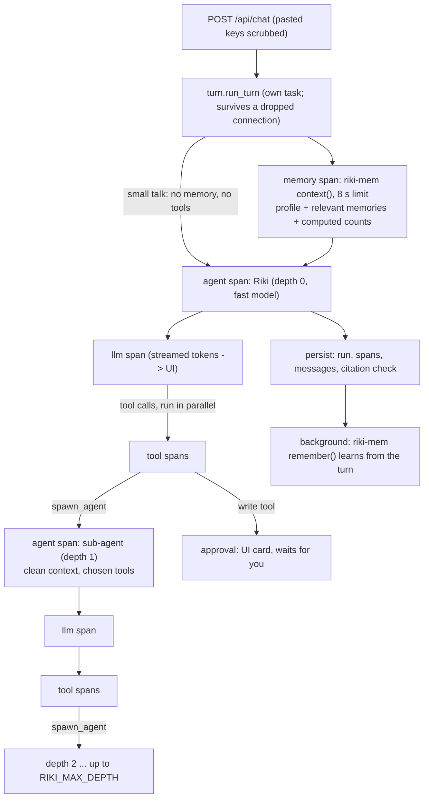

# Architecture

## One message, end to end

Every box with "span" is a row in `spans`, linked by `parent_id`. The UI draws that tree live from the
SSE stream and again from `/api/runs/{id}` for past answers.

### A run belongs to the server, not to the browser tab

`turn.start_run` starts the run in its own task and registers it in `rt.runs`. Every event goes into the
run's own list (`RunContext.events`); a client is only a reader of that list (`RunContext.follow(from)`).
So leaving the chat, switching tabs, refreshing or losing the connection never loses a reply or an
approval: the chat asks `GET /api/live`, and if its thread has a run in progress it reattaches with
`GET /api/runs/{id}/stream?from=N` and gets the whole history, then the rest live. A chat takes one message
at a time (`POST /api/chat` answers 409 with the busy run's id). `POST /api/runs/{id}/stop` cancels a run,
including one waiting for approval; it ends as `stopped` and says so in the chat. Whatever happens
(error, stop, a failed trace write), the run always ends with a `run_end` event and a saved reply. Runs left
`running` by a restart are closed with an "interrupted" message on startup. Finished runs stay
followable for two minutes. Control characters Postgres refuses (U+0000) are removed at the door
(`tracing.clean`), because one of them in a web page used to make the whole reply unsaveable.

## The agent graph

`app/agent/graph.py` compiles one LangGraph `StateGraph` with two nodes:

- **model**: binds the agent's current tools, streams the reply, records tokens (and cache reads).
- **tools**: runs all tool calls of a turn concurrently, through the risk policy, with a timeout,
  and truncates long outputs before the model sees them (the full output stays in the trace).

State is `messages` plus `tools` (the names this agent may call right now). Per-agent settings
(system prompt, model tier, depth) travel in the LangGraph config, so the same compiled graph serves
every agent at every depth.

**Nesting.** `spawn_agent(task, context, tools, smart)` runs the same graph one level deeper. The
sub-agent sees only its task and the context it was handed, never the parent's conversation, and the
parent sees only the sub-agent's final reply. That isolation is what keeps long multi-step work from
polluting the main context. A sub-agent always has `current_time`, `recall_memory` and `load_tools`;
it gets `spawn_agent` only while it is above the depth limit.

**Limits per run:** depth (`RIKI_MAX_DEPTH`, default 3), number of sub-agents
(`RIKI_MAX_AGENTS_PER_RUN`, 12), steps per agent (`RIKI_MAX_STEPS_PER_AGENT`, 12), total tokens
(`RIKI_RUN_TOKEN_BUDGET`, 300k), per-tool timeout (`RIKI_TOOL_TIMEOUT_S`, 60 s; sub-agents are bounded
by their own limits instead), whole-run timeout (`RIKI_RUN_TIMEOUT_S`, 600 s). Hitting a limit ends that
agent with a plain-language message, never a crash. On its last step an agent gets no tools and must answer
with what it found. An agent repeating a tool call with identical arguments is refused and told to use the
earlier result.

## Tokens and latency

| Technique | Where | Effect |
|---|---|---|
| Fast model for the main agent; smart model only on request | `runtime.py`, `spawn_agent(smart=true)` | Low latency for everyday turns |
| Tool catalog instead of tool schemas | `ToolRegistry.catalog`, `load_tools` | Dozens of MCP tools cost one line each until used |
| Byte-stable system prompt | built once at startup | Bedrock prompt caching (`cache_control` adds cache points on system, tools and last message); cache reads shown per span and per day |
| Time and memories in the user message, not the system prompt | `turn.py` | Changing context doesn't break the cached prefix |
| History is text only, last `RIKI_HISTORY_TURNS` turns | `turn._history` | Old tool output never re-enters context |
| Sub-agent isolation | `spawn_agent` | Research chatter stays out of the main context |
| Tool output truncation (`RIKI_TOOL_OUTPUT_CHARS`) | `Agent._run_tool` | One huge page can't flood a context |
| riki-mem rerank off; regex-planned search (`RIKI_MEMORY_PLANNER=heuristic`); 8 s time box | `MemoryConfig`, `turn.py` | No planner model call before answering; a slow lookup can't hold the reply (the model still has `recall_memory`) |
| Small talk ("hi", "thanks") gets no memory lookup and no tools | `turn.is_small_talk` | One model call instead of a lookup plus a tool-eager turn |
| Prompt: answer from knowledge first, search only for live facts, no helpers for one lookup | `prompts.MAIN` | Fewer tool rounds on questions the model already knows |
| Persistent MCP sessions | `agent/mcp.py` | No process start per tool call |
| Spans buffered in memory, written once per run | `tracing.py` | No database round trips on the hot path |
| Parallel tool calls and sub-agents | `asyncio.gather` | Wall time = slowest branch, not the sum |
| `temperature=0` | `runtime._model` | Consistent answers; pass^k evals measure it |

## Product surfaces (what the UI is built on)

| UI | API | Notes |
|---|---|---|
| Setup | `GET/POST /api/onboarding`, `POST /api/onboarding/scan`, `POST /api/onboarding/facts` | Shown until done or skipped (`persona.onboarded`). You pick a role (`apps.json` `roles`: apps to suggest, Home starters, check-in list) and say a few lines about yourself (learned like a chat turn). The scan is a run with `source="onboarding"`: it reads connected apps through helpers, every change is refused in code, and its "- fact" lines are only saved when you tick them (`source_key` points back to the scan) |
| Home | `GET /api/today` | Pending approvals, recently active chats, today's check-in note, memories learned since local midnight |
| Main chat / side chats | `GET /api/threads/main`, `GET /api/threads`, `PATCH /api/threads/{id}`, `DELETE /api/threads/{id}`, `POST /api/chat`, `GET /api/runs/{id}/stream?from=N`, `POST /api/runs/{id}/stop` | `threads.kind` = main, side or heartbeat; list carries a plain-text preview and `last_at`; short titles are replaced by the first real message. Delete removes a side chat; for the main chat it clears the messages. Neither is allowed while a run is in progress (409) |
| Steps under a reply | `GET /api/threads/{id}/messages` | Layer 2 of the status display |
| Details drawer | `GET /api/runs/{id}` | Layer 3: the full trace |
| Avatar mood, status dot, the Island | SSE events in the open chat; `GET /api/live` every 2 s everywhere (runs in progress and approvals waiting, from every chat and check-in); `GET /api/status` every 6 s for health | Layer 1. The Island is server-driven, so it is right on every page |
| Approvals | `GET /api/approvals`, `POST /api/approvals/{id}` | Pending approvals survive navigation, not restarts. Stopping a run settles its approval as expired |
| Memory | `GET /api/memories`, `PATCH /api/memories/{id}`, `DELETE /api/memories/{id}` | Corrections create a new version through riki-mem; `source` links a memory to the chat it came from |
| Activity | `GET /api/activity?q=` | Requests Riki worked on (also while still running, waiting for your OK, stopped or failed; plain answers stay in their chat), non-read tool calls (done, refused, failed) and memories, newest first. Refreshes every 5 s |
| Settings | `GET/PUT /api/persona`, `PUT/GET/DELETE /api/persona/avatar`, `GET /api/heartbeat`, `POST /api/heartbeat/run`, `GET /api/export`, `GET /api/status`, `GET /api/logs`, `GET /api/evals`, `GET /api/metrics`, `GET /api/tools` | Persona edits rebuild the system prompt (`runs.prompt_version` = template hash + persona hash). Check-ins skip `RIKI_QUIET_HOURS`. Export is one JSON file |

## Data

Alembic manages Riki's tables (`backend/alembic/`): `threads`, `messages` (user text and final answers
only), `runs` (status, tokens, latency, prompt version, citation checks), `spans`, `approvals`,
`feedback`, `eval_runs`. riki-mem keeps its own tables in the same database and migrates them itself;
Riki's Alembic env ignores them, so neither side can drop the other's tables. The app refuses to start if
the database isn't at the Alembic head.

Changing a model in `app/db.py` needs a migration:
`uv run alembic revision --autogenerate -m "what changed"`, then review it. `tests/test_api_and_migrations.py`
fails when models and migrations disagree.

## Why these choices

- **LangGraph loop, hand-written nodes** rather than a prebuilt agent: the policy check, approvals,
  truncation, budgets and tracing all live in two small nodes we control.
- **Own trace store** rather than an external tracing SaaS: the UI needs the tree, it's single-user,
  and the trace is part of the product ("why did you say that?"). Exporting to OpenTelemetry later is a
  straight mapping of the `spans` table.
- **Approvals are database rows, not graph checkpoints.** A request waits up to 24 h as an awaited future *and* as a row
  (`approvals`: thread, a hash of the tool and arguments, status, the result once it ran). If Riki restarts while a run
  waits, the next start runs that request again (`ops.resume_waiting_runs`); the repeated call finds the same row, so the
  same card is still there, and an action that already ran is handed back its stored result instead of running twice.
  The model does repeat its reasoning (tokens) after a restart; nothing it already did is repeated. Only chat runs
  waiting for you are resumed; a run that was mid-flight is closed as interrupted. # shortcut: replay with memoized
  writes, not LangGraph's Postgres checkpointer (which needs a different driver on Windows and per-agent resume logic);
  upgrade if replaying long read-only research after a restart becomes a real cost.
- **"Allow for 30 minutes"** is a row in `approval_grants` (chat + tool). Tools that move money (`policy.moves_money`)
  never get one and always ask.
- **ask_user** reuses the approval row for a question: the options are the arguments, the answer is stored as the result.

## Riki between chats

`ops.heartbeat_loop` ticks every minute: it fires due schedules (claimed with `FOR UPDATE SKIP LOCKED`, so never twice)
and, every five minutes, starts `ops.background_work` unless the daily budget is 80% used: `cognition.refresh_reflection`
(a new read on you after 10 new memories), `learn_lessons` (a chat quiet for 6 h yields up to 3 preference memories) and
`run_cycle` (every `RIKI_COGNITION_INTERVAL_H`, outside quiet hours, only if something is new: think on the stronger model,
then act on the fast one, then the guards in code: one nudge a day at most, none within 3 h of a chat, none on a topic used
this week, and twice as long a wait after three ignored in a row). Each job is a run of its own (`jobs.job_run`), so it is
traced and priced. `notify` puts what Riki says into the check-in thread and on Telegram.

## Settings you can change in the app

`settings_store.py`: a whitelist (`EDITABLE`: thinking on/off and interval, quiet hours, daily cap, prices, sandbox, default
effort, time zone, your name) stored in `app_settings`, applied to the one running `Settings` object in place (everything
holds a reference to it, so no restart), re-applied at start over `.env`, and reset per key with `null`. Switching the sandbox
adds or removes `run_python`; changing your name rebuilds the prompts. `GET/PUT /api/settings`, `GET /api/nudges`,
`GET/DELETE /api/grants` feed the Settings page.

## The phone and files

`channels/telegram.py` long-polls Telegram for ONE chat id. It is connected from Settings: `POST /api/telegram` checks the
bot token (`getMe`) and stores it encrypted (`apps.secret_box`) in `app_settings`; the channel then waits for a one-time code
(10 minutes, in memory, 5 wrong guesses lock it), and the first private chat to send it is paired. Until then every message
is ignored without an answer. Everything said over Telegram lands in one permanent thread (`kind="telegram"`, always listed
under the main chat); a message written in that thread in the app is answered on the phone too, and `notify` keeps what it
sends to the phone in the same thread. `RIKI_TELEGRAM_*` in `.env` only seeds a connection once. Approvals and
`ask_user` questions go to the phone as buttons from any chat (`policy.NOTIFIERS`). Uploads (`POST /api/uploads`) are turned
into text (PDF, Word, Excel, CSV, text) and read with `read_file` the way `fetch_url` reads a page. `run_python` is a
Docker container with no network when `RIKI_SANDBOX=true`.

## Apps (`app/apps.py`, `app/apps.json`)

Apps are remote MCP servers you connect from the Apps tab, next to the fixed servers in `mcp.json`.

- **Catalog**: `apps.json` lists ~30 apps with checked endpoints, grouped by what they hold (Mail, calendar &
  docs; Money; Food & shopping; Work; Code; Knowledge; Thousands more). Search also reaches the official MCP
  Registry (`/api/apps/directory`), and any MCP link can be added by hand (`/api/apps/custom`).
- **Sign-in**: the MCP SDK's `OAuthClientProvider` (discovery, dynamic client registration, PKCE). Riki opens
  the app's sign-in page in a small window; the app redirects to `/api/apps/callback`, which resolves the
  waiting flow by its one-time `state`. Google needs your own OAuth client (no dynamic registration). Key-based
  apps (GitHub, Zapier) take a pasted key.
- **Lifetime**: each connected app runs in its own task that owns its MCP session until you disconnect (anyio
  sessions must close in the task that opened them). Apps reconnect in the background at startup with stored
  tokens; one that needs a fresh sign-in shows "Sign in again" instead of blocking startup.
- **Tools**: registered as `<app>_<tool>`, removed on disconnect; the system prompt is rebuilt each time. The
  catalog shows one line per app (`notion_* (...): search, fetch, create-pages*, ...`) and `load_tools(["notion_*"])`
  loads all of them, so ten connected apps cost ten catalog lines, not 150.
- **Risk** (`apps.tool_risk`): tool names whose verb reaches people (send, reply, share, invite, post,
  comment...) are `external` for every app; the app's `safe_tools` patterns and, for listed apps, MCP
  `readOnlyHint` make a tool `safe`; everything else is `write`. A server you added yourself only gets `safe`
  from a read-only hint when the name also starts with a read verb. "Read only" mode doesn't register `write`
  tools at all. Hubs (Zapier, Rube) run other apps' actions by slug inside one tool, so their arguments are
  checked too (`ToolEntry.reaches_people`).
- **Native apps**: an entry with `"native": "web_search"` (Tavily) is not an MCP server. Connecting it checks the
  key against the provider, then switches on a built-in tool that reads the key from the same encrypted store
  (`Apps.token`). Without the key, `web_search` falls back to DuckDuckGo and says so in its result.
- **The agent knows apps**: the system prompt lists the connectable app ids; the `connect_app` tool (main agent
  only) puts a card in the chat (`ConnectCard`: key field for token apps, a button to the app's sheet in Apps
  otherwise). The card is drawn from the tool call's arguments; the key goes browser -> `/api/apps/{id}/connect`.

## Next steps (not built yet)

- A Drafts outbox for things Riki writes but you send.
- A checkpointer if replaying a long run after a restart gets expensive (see approvals above).
- Durable memory writes (see riki-mem improvements: an outbox).
- Startup timeout per MCP server (a server that hangs on start currently delays startup).
